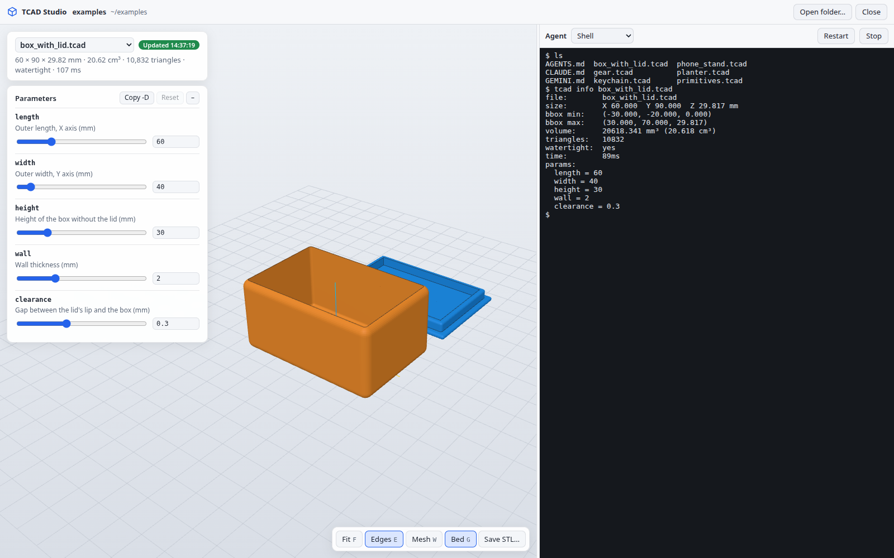

# TCAD Studio

**Design printable 3D parts by talking to a coding agent, and watch them take
shape in 3D as it works.**



TCAD Studio is a desktop app with two panels. On the right, a coding agent
(Claude Code, Codex, Gemini CLI, Antigravity or a plain shell) works in a
folder of your choice. On the left, a live 3D preview shows the models in that
folder and updates as soon as the agent saves a file. Ask for "a box with a
snap-on lid, 60×40 mm" or "make the walls thicker", and you see the result a
moment later.

The models are plain-text `.tcad` files in **TCAD**, a small language for
modeling with solids and holes: you place primitives (boxes, cylinders, spheres,
text...) and mark some of them as holes. The files are easy for an agent to
write and easy for you to read and tweak. Every model can export a print-ready
STL.

## Features

- **Live 3D preview** of every model in the folder and its subfolders, with a
  dropdown to switch between them. It **jumps by itself to the file the agent
  just created or saved**.
- **Parameters panel**: each `param` of a model gets a slider, number field,
  checkbox, text field or dropdown. Changes rebuild the model instantly
  without touching the file, and the agent can see them.
- **Agent terminal** in the project folder, with the TCAD skill, instructions
  and the `tcad` tool ready for the agent to use.
- **Checks you can trust**: dimensions, volume, triangle count and whether the
  mesh is watertight; build errors show the line and column, and the preview
  keeps the last valid version.
- **STL in and out**: save the STL of any model wherever you want, or import an existing
  STL and have it rebuilt from primitives where possible.
- Everything runs locally and works offline (three.js and xterm.js are
  bundled).

## Getting started

Requirements: Go 1.26 or later, and on Linux GTK3 and WebKitGTK 4.1
(`sudo apt install libgtk-3-dev libwebkit2gtk-4.1-dev`). To use the agents, have
their CLIs installed (`claude`, `codex`, `gemini`...); the studio lists the
ones it finds on your `PATH`.

```bash
make studio                     # builds bin/tcad-studio
bin/tcad-studio                 # start screen: open a folder or a recent one
bin/tcad-studio ~/designs       # straight into a folder
make run-studio FOLDER=examples # the same, through make
make install-studio             # installs tcad-studio into $GOPATH/bin
```

Without `make`: `go build -tags gtk3 -o bin/tcad-studio ./cmd/tcad-studio`. To
build against Wails' default GTK4 / WebKitGTK 6.0 instead, `make studio GO_TAGS=`.
The app is built with [Wails 3](https://v3.wails.io).

The same app also runs in a browser, without Wails: `tcad studio ~/designs -open`
(see [Command line](#command-line)).

## Working in TCAD Studio

**A folder is a project.** Open any folder (an empty one is fine) and ask the
agent for parts. Each part is a `.tcad` file; an assembly of several parts
usually gets its own subfolder (`station/base.tcad`, `station/lid.tcad`...).
You can also edit the files yourself in any editor: the preview reloads on
every save.

When it opens a folder, TCAD Studio writes what the agent needs into it:

| File | What it is |
|---|---|
| `.agents/skills/tcad/`, `.claude/skills/tcad/` | The TCAD skill (the language, its reference and design recipes) where each agent looks for it: `.agents/skills` for Codex, Gemini CLI and Antigravity, `.claude/skills` for Claude Code. Refreshed every time the folder is opened. |
| `AGENTS.md` | Instructions for the agent: how the preview works, how to check its work, rules. Only a marked block is managed; whatever you write outside it is kept. |
| `CLAUDE.md`, `GEMINI.md` | `@AGENTS.md`, only if they don't exist. |
| `.tcad/preview.json` | What you are looking at: model, errors, dimensions, `params` and the values you changed in the panel. That's how the agent knows what "this part" means. It has its own `.gitignore`. |

The agent's terminal has `tcad` on its `PATH` (`tcad-studio` itself acts as
`tcad`), so the agent can validate its models, render PNG previews to check
them visually and export STLs without installing anything else.

**In the preview:**

- Mouse: orbit (left button), pan (right), zoom (wheel).
- Keys: `F` fit the view, `E` edges, `W` triangle mesh, `G` bed, `N` /
  `Shift+N` next / previous model.
- Changed parameters are marked with ●; reset them one by one or all at once.
  "Copy -D" copies them as command-line options. If you want to keep them, ask
  the agent: it can see them in `.tcad/preview.json` and write them into the
  file.
- "Save STL…" opens a save dialog to write the model as a standard STL
  anywhere you want (it starts next to the model, then wherever you saved
  last). In the browser versions it is a plain "Download STL". `.color()`s in
  the model are only used for the preview.

## The TCAD language

```tcad
param width  = 60   // [30:150] Outer width (mm)
param depth  = 40   // [30:150] Outer depth (mm)
param height = 25   // [10:100] Height (mm)
param wall   = 2    // [1.2:0.2:4] Wall thickness (mm)

group {
  box(width, depth, height, radius=3)
  hole box(width - 2*wall, depth - 2*wall, height, radius=1).move(z=wall)
  hole text("TCAD", size=8, height=1).rotate(x=90).move(y=-depth/2 + 0.6, z=height/2)
}
```

- **Primitives**: `box`, `cylinder`, `cone`,
  `sphere`, `half_sphere`, `torus`, `tube`, `paraboloid`, `wedge`, `roof`,
  `round_roof`, `pyramid`, `polygon`, `star`, `heart`, `icosahedron`, `text`,
  plus `extrude` (your own 2D polygon), `revolve` (a revolved profile), `stl`
  (import a file) and `polyhedron` (an arbitrary mesh).
- Every primitive is created **centered in X/Y and resting on z = 0**, as if
  dropped on the workplane. Units are mm.
- `hole` turns a shape into a hole. `group { ... }` joins the solids and
  subtracts the holes from them (in any order); `intersect { ... }` keeps only
  what they have in common.
- Chainable modifiers: `.move() .rotate() .scale() .mirror() .drop() .center() .color()`.
- `param`, `let`, `for x in range(n)`, `if/else`, `module` (components with
  parameters), `func` (single-expression functions), lists, operators, math
  functions in degrees, and `$sides`/`$steps` for the resolution of curves.
- A `param`'s comment sets its control in the parameters panel, like in the
  OpenSCAD Customizer: `// [min:max] Description` or `// [min:step:max]`.
  Parameters with a closed set of values are declared with `in` and show up as
  a dropdown; unlike ranges, the values are checked:

  ```tcad
  param mode = "assembled" in ["assembled", "print"]   // View or separate parts
  ```

The full specification is in
[`.agents/skills/tcad/reference.md`](.agents/skills/tcad/reference.md), and
there are recipes (fasteners, lids, slots, arrays, text...) in
[`.agents/skills/tcad/patterns.md`](.agents/skills/tcad/patterns.md).
[`examples/`](examples) has complete models: a catalog of primitives, a box
with a lid, a keychain, a gear, a planter with a saucer and a phone stand.

## Command line

Everything the studio does is also available from the `tcad` command, which is
pure Go (no cgo, no GUI libraries) and handy for scripts, CI or working
without the app.

```bash
make                # builds bin/tcad (or: go build -o bin/tcad ./cmd/tcad)
make install        # installs it into $GOPATH/bin
```

| Command | Description |
|---|---|
| `tcad build model.tcad [-o x.stl] [-ascii]` | Generates the STL (binary by default). |
| `tcad render model.tcad [-o x.png] [-view all] [-size 500]` | PNG preview: a 2x2 sheet (iso, front, right, top) or a single view (`iso`, `iso-back`, `iso-below`, `front`, `back`, `left`, `right`, `top`, `bottom`). |
| `tcad info model.tcad` | Dimensions, bounding box, volume, number of triangles, whether the mesh is watertight, and the values of the `param`s. |
| `tcad check model.tcad` | Only validates the file. |
| `tcad watch path... [-R] [-addr localhost:8080] [-o x.stl] [-no-stl] [-open]` | The studio's 3D preview on its own, in the browser. See below. |
| `tcad studio [folder] [-addr 127.0.0.1:0] [-open]` | TCAD Studio in the browser (preview + agent). |
| `tcad import part.stl [-o x.tcad] [-mode shapes\|embed\|ref] [-center]` | Converts an STL (binary or ASCII) into a TCAD model. See below. |
| `tcad shapes` | List of primitives with their parameters and defaults. |

They all accept `-D name=value` (repeatable) to override a `param`, and `-` as
the file to read from standard input:

```bash
tcad build box.tcad -D width=80 -D height=30 -o box.stl
```

`tcad-studio` also accepts all these commands (`tcad-studio build x.tcad`), so
the desktop app is enough on its own.

### Live preview without the app: `tcad watch`

```bash
tcad watch designs/stand.tcad -open
# watching designs/stand.tcad, viewer at http://127.0.0.1:8080
tcad watch -R designs -open              # every model in designs/ and its subfolders
```

It serves the studio's preview in the browser: the same 3D viewer, parameters
panel and model dropdown, rebuilt on every save. Unlike the studio, it also
rewrites each model's STL after every build (`designs/stand.stl`, or the file
given with `-o` for a single model; `-no-stl` turns it off).
`-addr 0.0.0.0:8080` opens it to the local network, and the initial `-D`s are
loaded into the panel.

The page talks to `tcad watch` through a JSON API that can also be used from
scripts:

| Request | Effect |
|---|---|
| `GET /api/state` | State: model shown (`model`, `models`), last build, dimensions, `params` (type, value, default, annotations) and `overrides`. |
| `GET /api/model`, `PUT /api/model` with `{"model": "examples/planter.tcad"}` | Model shown and list of models; pick another one (400 if it is not in the list). |
| `PUT /api/params` with `{"height": "45", "font": "\"mono\"", "wall": null}` | Changes values (TCAD expressions, as with `-D`; `null` removes the change). Validates name and type (400 if they don't fit) and rebuilds. |
| `DELETE /api/params` | Back to the values in the file. |
| `GET /events` | Server-Sent Events with the state after every build. |
| `GET /model.stl`, `GET /download.stl` | The model with colors (for the viewer) and the standard STL. |

### Importing STL

```bash
tcad import part.stl                  # generates part.tcad
```

There are three conversion modes:

- **`shapes`** (the default) rebuilds each body from primitives whenever it
  can. It splits the mesh into connected bodies and analyzes each one:
  - tessellated spheres become `sphere`;
  - parts that are stacked extrusions along any axis (plates, gears, boxes
    with sharp corners, profiles...) are rebuilt layer by layer: each outline
    becomes a `box`, `cylinder`, `polygon` or `extrude`, and its through holes
    become `hole`s, also recovering the 3D rotation;
  - internal cavities become `hole`s;
  - whatever can't be described that way (free-form curved surfaces,
    roundings, tori...) is kept exactly as a `polyhedron`.
- **`embed`** copies the exact mesh into a `polyhedron` inside the `.tcad`.
- **`ref`** only writes `stl(file="part.stl", center=false)`, a reference to
  the original file.

`-center` moves the part to the workplane (centered in XY, z = 0). After
converting, `tcad import` evaluates the generated model and compares its volume
with the original STL's.

Example: the STL of the gear in `examples/` (18,790 triangles, 635 KB in
`embed` mode) becomes 13 readable lines:

```tcad
group {
  extrude(points=[...outline of the teeth...], height=6)
  hole cylinder(radius=4, height=8, sides=64).move(x=11, z=-1)
  ...
  hole polygon(sides=6, radius=4, height=8).move(z=-1)
}
group {
  cylinder(radius=7, height=1, sides=64)
  hole cylinder(radius=5, height=3, sides=64).move(z=-1)
}.move(z=6)
```

STL files can also be used directly in a model, as a solid or as a hole:
`hole stl("screw.stl").move(z=5)`.

## Agent skill

[`.agents/skills/tcad/`](.agents/skills/tcad) holds a skill that teaches an
agent the language and a design workflow: write the model, validate it with
`tcad info`, render it and **look at the image** to fix mistakes, and generate
the STL. It uses the open [Agent Skills](https://agentskills.io) format (a
`SKILL.md` with a `name` and a `description`, plus reference files), so every
agent the studio supports can use it:

| Agent | Where it looks for skills in a project | For all your projects |
|---|---|---|
| Codex | `.agents/skills/` | `~/.agents/skills/` |
| Gemini CLI | `.agents/skills/` (or `.gemini/skills/`) | `~/.agents/skills/` (or `~/.gemini/skills/`) |
| Antigravity | `.agents/skills/` | see the Antigravity docs |
| Claude Code | `.claude/skills/` | `~/.claude/skills/` |

In this repository `.claude/skills/tcad` is a link to `.agents/skills/tcad`, so
every agent finds the skill when working here. TCAD Studio writes a copy into
both `.agents/skills/tcad/` and `.claude/skills/tcad/` of every folder it
opens, plus an `AGENTS.md` (read by Codex, and by Claude Code and Gemini CLI
through `CLAUDE.md` and `GEMINI.md`) that points the agent to it. To use the
skill anywhere else, copy the folder to one of the locations above and make
sure `tcad` is on the `PATH`.

## Development

```bash
make test           # tests (make race: with the race detector)
make check          # format + vet + tests + build the examples (for CI)
make examples       # STLs of examples/ into out/  (make renders: the PNGs)
make studio-web FOLDER=examples   # the studio in the browser, from bin/tcad
make help           # every target
```

### How it works

```
.tcad file ──► lexer/parser ──► AST ──► interpreter ──► meshes per primitive
               (internal/dsl)            │
                                         ▼
                      CSG with BSP trees (internal/csg)
                      union / difference / intersection
                                         │
                                         ▼
             vertex welding + T-junction repair (internal/stl)
                                         │
                      ┌──────────────────┴──────────────────┐
                      ▼                                     ▼
                binary/ASCII STL                 PNG (software rasterizer,
                                                  internal/render)
```

The studio is a local web app: `internal/studio` is a server on 127.0.0.1 (a
free port) that serves the page, mounts the `internal/watch` viewer at
`/preview/` for the open folder, and runs the agent terminals. The Wails window
(`cmd/tcad-studio`) only shows that server and provides the native folder
dialog; `tcad studio` serves the same thing for a browser, with its own folder
browser. Each session has a random token: the start URL carries it, the page
keeps it in a `SameSite=Strict` cookie, and the server rejects requests
without it, from other origins or with another `Host`.

- `cmd/tcad-studio`: the desktop app (Wails 3). `cmd/tcad`: the command line.
- `internal/studio`: the studio backend (folders, session, agent terminals)
  and its page. It bundles xterm.js 6 (MIT license, in `internal/studio/assets`).
- `internal/terminal`, `internal/agentctx`: the agents' PTYs and the context
  files written into every folder.
- `internal/watch`: the live viewer. It discovers the models of the given
  paths, polls the files, rebuilds the chosen one, notifies the page through
  Server-Sent Events and serves it an STL with per-facet colors. It is a
  reusable `http.Handler` (`tcad watch` serves it on its own; the studio mounts
  it under `/preview/`). It bundles three.js r160 (MIT license, in
  `internal/watch/assets`).
- `internal/cli`: the `tcad` commands, run by both binaries.
- `internal/model`: loading a `.tcad` (parsing, evaluation and a mesh ready to
  write).
- `internal/dsl`: lexer, parser and interpreter of the language.
- `internal/geom`: vectors, affine transforms and triangle meshes.
- `internal/shapes`: generators for every primitive (revolutions, extrusions,
  rounded box, text from the Go fonts through `x/image/font/sfnt`).
- `internal/csg`: BSP booleans (based on csg.js) that only clip the polygons
  near the other operand, which greatly reduces fragmentation.
- `internal/importer`: mesh to TCAD conversion (detection of bodies, spheres,
  and stacked extrusions by slicing each layer halfway up).
- `internal/stl`: STL reading/writing and post-processing so the mesh is
  watertight (`tcad info` checks it by counting edges not shared by two
  triangles).
- `internal/render`: supersampled z-buffer, shading and edge detection.

## Limitations

- The desktop app is tested on Linux; macOS and Windows builds are untested,
  and there is no packaging (installers, icons) yet.
- There is no `hull` or `minkowski`; rounded shapes are made with the
  `radius`/`bevel` parameters or by combining primitives (see `patterns.md`).
- The CSG works in floating point: in very degenerate cases (many parts
  crossing exactly on the same axis) a few microscopic open edges may be left;
  `tcad` warns about it and slicers repair them by themselves.
- Very dense meshes (spheres with high `steps`, `$sides` > 128) make the CSG
  slow.
- `tcad import` doesn't decompose shapes with roundings or free-form surfaces
  into CSG operations: those bodies are kept as an exact `polyhedron` (editable
  with added holes and solids, but not parametric).
- The fonts available for `text` are the Go fonts (sans and mono, with bold
  and italic variants).
